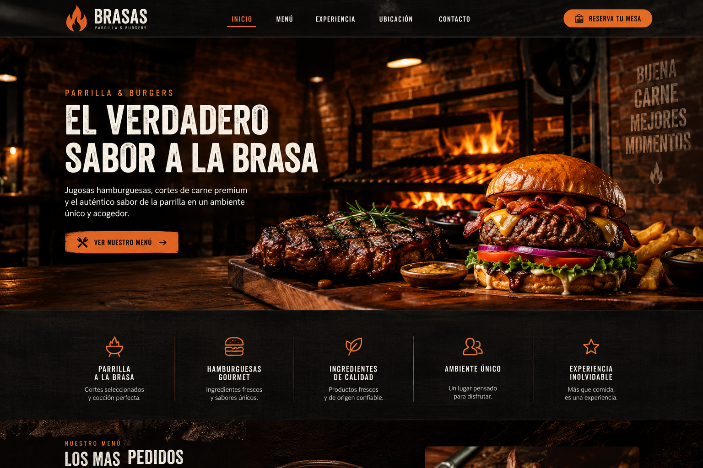
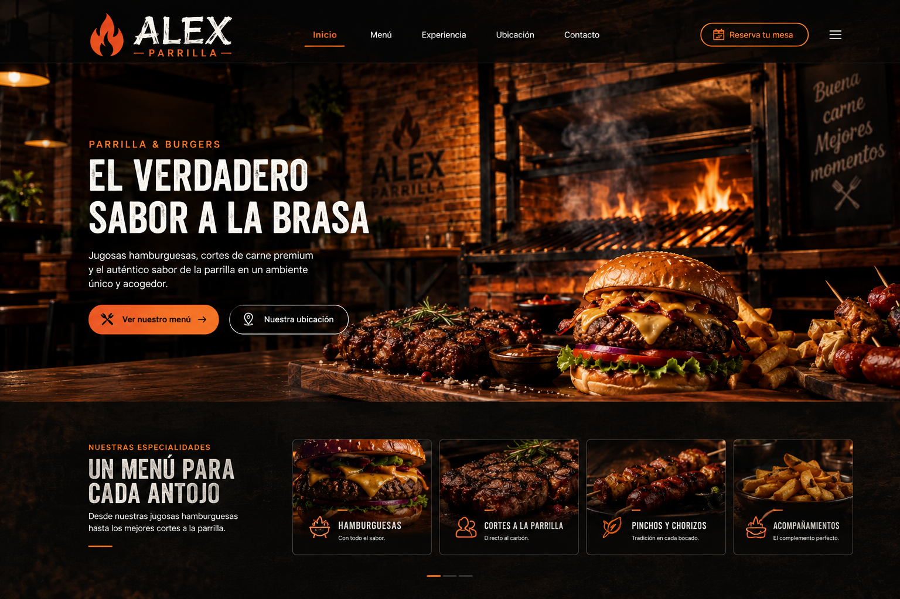
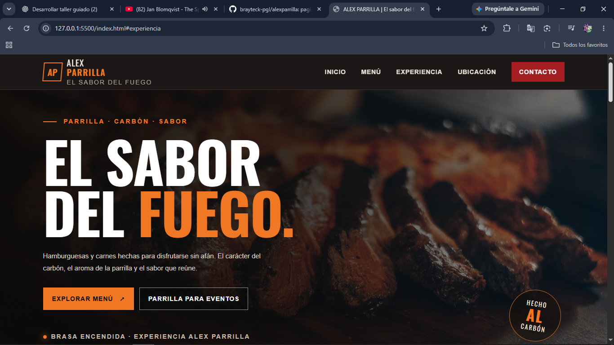

# Taller: Creación de propuestas y maquetaciones web con IA
## Proyecto: ALEX PARRILLA

**Tecnologías:** HTML5, CSS3 y JavaScript puro.  
**Alcance:** sitio demostrativo responsive, sin frameworks ni backend.

## 1. Brief del proyecto

### Propósito
Mostrar los productos del restaurante, atraer clientes y diferenciar la marca mediante una identidad visual atractiva que transmita calidad gastronómica.

### Audiencia
Público general, principalmente personas entre 16 y 45 años. La experiencia prioriza dispositivos móviles y se adapta a tabletas y computadores.

### Contenido
1. Inicio.
2. Menú.
3. Experiencia / Galería.
4. Ubicación.
5. Contacto.

También se presenta el servicio demostrativo de parrilla para eventos, tanto a domicilio como en el establecimiento.

### Estética
Parrilla urbana premium con elementos rústicos: ladrillo a la vista, carbón, fuego y madera. Paleta: negro carbón (#171412), rojo parrilla (#A51E22), naranja fuego (#F07824) y tonos beige cálidos. Hamburguesas y carnes son protagonistas; pinchos y chorizos tienen presencia secundaria.

## 2. Priming

**Objetivo:** proporcionar contexto, rol, tecnologías, restricciones y forma de trabajo a la IA.

**Prompt utilizado (resumen):**

> Actúa como desarrollador frontend con experiencia en HTML5, CSS3 y JavaScript puro. Vamos a crear ALEX PARRILLA, restaurante de hamburguesas y carnes al carbón. La página debe mostrar Inicio, Menú, Experiencia/Galería, Ubicación y Contacto; dirigirse al público general de 16 a 45 años y priorizar móviles. Usa estética urbana premium y rústica con ladrillo, carbón, madera, negro, rojo y naranja fuego. Hamburguesas y carnes son protagonistas; pinchos y chorizos discretos. Separa index.html, style.css y app.js. No uses frameworks ni librerías externas, prioriza accesibilidad, claridad y mantenibilidad. Primero presenta la propuesta y espera aprobación antes de programar. No inventes datos comerciales.

**Aprendizaje:** definir contexto y restricciones reduce resultados fuera del alcance, retrabajo y dependencias no deseadas.

## 3. Meta-prompting

**Objetivo:** pedir a la IA que ayude a construir mejores instrucciones antes de solicitar el diseño.

**Prompt utilizado (resumen):**

> Actúa como especialista en Prompt Engineering y desarrollo frontend. Ayúdame a construir un prompt completo para diseñar ALEX PARRILLA. Identifica información faltante sobre propósito, audiencia, secciones, identidad visual, productos, eventos, navegación, interacciones, responsive, tecnologías y restricciones. Organiza una plantilla, explica cada apartado y formula preguntas. No generes código ni propuesta definitiva hasta aprobar el prompt.

**Aprendizaje:** Meta-prompting permite descubrir requisitos omitidos y estructurar instrucciones más completas; no garantiza un resultado perfecto y requiere validación humana.

## 4. Comparación de técnicas de prompting

Se trabajaron las cuatro técnicas utilizando el contexto de ALEX PARRILLA. Los siguientes ejemplos describen cómo se aplicaron y comprendieron durante el taller.

### Zero-shot
Se solicita una propuesta sin ejemplos visuales de otros restaurantes. La IA toma decisiones sobre secciones, paleta, tipografía, componentes, interacciones y responsive a partir de la instrucción.

**Ejemplo:** pedir una página para un restaurante de parrilla con colores oscuros, fotografías de hamburguesas y apariencia moderna, sin entregar referencias.

**Observación:** permite explorar una dirección propia sin condicionar el resultado con referencias específicas. No garantiza originalidad absoluta.

### One-shot
Se entrega un patrón de referencia: una tarjeta con fotografía, nombre, descripción, precio y botón de consulta.

**Observación:** un ejemplo orienta la estructura que se espera y permite adaptar ese patrón a otros productos.

### Few-shot
Se proporcionan varios ejemplos de tarjetas, por ejemplo una de hamburguesa, otra de carne a la parrilla y otra de bebidas. Todas comparten fotografía, nombre, descripción y precio.

**Observación:** varios ejemplos ayudan a identificar un patrón y mantener consistencia entre componentes.

### Chain of Thought / planificación por etapas
Se solicita organizar la tarea en pasos: analizar las necesidades del restaurante, definir las secciones, proponer el diseño, organizar la estructura y desarrollar el código por partes.

**Observación:** dividir el trabajo en etapas facilita revisar decisiones y controlar el avance. La documentación registra conclusiones y criterios, no razonamientos internos privados.

### Comparación

| Técnica | Qué se proporciona | Aporte | Limitación |
|---|---|---|---|
| Zero-shot | Instrucción sin ejemplos | Libertad creativa inicial | Puede asumir decisiones inesperadas |
| One-shot | Un ejemplo | Orienta un patrón concreto | El ejemplo puede limitar alternativas |
| Few-shot | Varios ejemplos | Consistencia entre componentes | Requiere elegir buenos ejemplos |
| Chain of Thought | Una tarea organizada por etapas | Organización y revisión del trabajo | Puede requerir más instrucciones |

Ninguna técnica es universalmente mejor; pueden combinarse según la necesidad. En este taller se estudiaron mediante prompts y ejemplos aplicados al proyecto; no se presentan como cuatro experimentos independientes con resultados medidos.

## 5. Propuesta visual seleccionada

Se combinan los aportes de las cuatro técnicas:
- Libertad de exploración de Zero-shot.
- Organización de tarjetas de One-shot.
- Consistencia de componentes de Few-shot.
- Planificación por etapas de Chain of Thought.

**Arquitectura:** Inicio, Menú, Experiencia/Galería, Ubicación y Contacto/Eventos.  
**Componentes:** encabezado, navegación, tarjetas de productos, filtros, galería, formulario, botones y pie de página.  
**Responsive:** mobile-first; puntos de adaptación CSS en 900, 680 y 380 px. Se validó manualmente a 360, 768 y 1200 px.

## 6. Implementación

- `index.html`: estructura semántica y contenido.
- `style.css`: identidad visual, Grid, Flexbox, variables y media queries.
- `app.js`: navegación móvil, filtros de menú, validación del formulario y preparación de consulta para WhatsApp.

**Funcionalidades incluidas:**
- Menú móvil desplegable.
- Filtros para productos.
- Validación de campos requeridos.
- Preparación de mensaje para WhatsApp cuando se configure el número real.
- Mensaje informativo si el número aún no está configurado.

**Límites:** no hay backend, almacenamiento ni envío de formularios a un servidor. El formulario de contacto/eventos es demostrativo. La configuración del número real de WhatsApp queda pendiente. Precios, productos, dirección, horarios y servicios son demostrativos y deben confirmarse antes de un uso comercial. Las imágenes externas requieren conexión a internet.

## 7. Validación y refinamiento

### Iteraciones trabajadas
1. Estructura HTML y correspondencia con el brief.
2. Paleta, tipografía y variables CSS.
3. Proporciones de tarjetas, galería y jerarquía de productos.
4. Navegación móvil, filtros y validación del formulario.
5. Media queries y adaptación a diferentes anchos.
6. Evolución de la identidad comercial: la propuesta inicial BRASAS se actualizó a ALEX PARRILLA. Se conservan ambas imágenes como evidencia del cambio de nombre y de la identidad elegida.

**Evidencia de evolución de marca**

| Identidad inicial | Identidad actual |
|---|---|
|  |  |

**Resultado visual final:**

### Comprobaciones estáticas registradas
- `node --check app.js`: aprobado en la revisión realizada.
- HTML analizado con parser: aprobado en la revisión realizada.
- IDs duplicados: no detectados.
- Siete imágenes con atributo `alt`.
- Elementos semánticos principales presentes.

### Pruebas manuales realizadas en el navegador

| Prueba | Resultado observado |
|---|---|
| Apertura de la página con Live Server | Correcta |
| Navegación desde el menú superior | Las secciones se desplazan correctamente |
| Visualización de tarjetas, productos, fotografías, nombres y precios | Correcta |
| Galería de Experiencia | Se visualiza correctamente |
| Botón de Experiencia hacia el formulario de eventos | Redirige a la sección del formulario |
| Sección Ubicación | Se visualiza correctamente |
| Sección Contacto y campos del formulario | Se visualizan y permiten escribir; el envío es demostrativo |
| Vista móvil, 360 px | Visualización correcta |
| Vista tableta, 768 px | Visualización correcta |
| Vista escritorio, 1200 px | Visualización correcta |
| Consola del navegador después de recargar | No se observaron errores en rojo |

**Evidencias incorporadas al repositorio:**

- Inicio de escritorio: [ver captura](evidencias/inicio-escritorio.png).
- Filtro de hamburguesas: [ver captura](evidencias/menu-hamburguesas.png.png).
- Formulario vacío y validación de campos obligatorios: [formulario vacío](evidencias/formulario-vacio.png.png) y [campos obligatorios](evidencias/campos-obligatorios.png.png).
- Formulario y aviso relacionado con WhatsApp: [ver captura](evidencias/formulario-whatsapp.png).
- Consola del navegador: [ver captura](evidencias/consola-sin-errores.png.png).
- Responsive 360 px: [ver captura](evidencias/responsive-360.png.png).
- Responsive 768 px: [ver captura](evidencias/responsive-768.png.png).
- Responsive 1200 px: [ver captura](evidencias/responsive-1200.png.png).
- Refinamiento de identidad: las dos propuestas y el resultado final están en la subsección `evidencias/refinamiento/` y se muestran arriba.

**Pendiente:** configurar y probar el enlace de WhatsApp con el número real. Esta configuración se deja para una etapa posterior y no se considera una función verificada en esta entrega. Los datos comerciales continúan siendo demostrativos.

No presentar capturas simuladas ni afirmar que se hicieron pruebas que no se ejecutaron.

## 8. Reflexiones finales

### 1. ¿Qué aportó la inteligencia artificial durante el desarrollo del proyecto?
Desde mi punto de vista, la inteligencia artificial aportó principalmente a la organización y al desglose de las tareas del proyecto, facilitando la planificación de cada etapa. También fue una herramienta de apoyo para generar y estructurar el código, permitiendo materializar las ideas y los objetivos que habíamos propuesto.

Considero que su principal ventaja es el ahorro de tiempo durante el desarrollo, ya que permite agilizar diferentes actividades y concentrarnos en la construcción de la solución. Sin embargo, es importante tener claridad sobre lo que queremos desarrollar y revisar los resultados que genera.

### 2. ¿Qué dificultades encontraste al trabajar con inteligencia artificial?
Una de las principales dificultades fue lograr que la inteligencia artificial comprendiera exactamente lo que quería expresar, utilizando palabras sencillas y sin conocimientos técnicos avanzados. En algunas ocasiones fue necesario explicar nuevamente las ideas, agregar detalles y ajustar las instrucciones para obtener resultados más cercanos a lo que buscaba.

También considero que todavía estoy desarrollando mis habilidades en Prompt Engineering, por lo que este ejercicio me permitió comprender la importancia de escribir instrucciones claras, específicas y bien organizadas para mejorar las respuestas de la IA.

### 3. ¿Qué aprendiste sobre las técnicas de prompting?
Durante el taller comprendí que existen diferentes técnicas para darle instrucciones a la inteligencia artificial. Aprendí que podemos trabajar sin ejemplos (Zero-shot), proporcionar un ejemplo (One-shot), entregar varios ejemplos (Few-shot) o dividir una tarea en diferentes etapas (Chain of Thought).

Considero que estas técnicas permiten mejorar la comunicación con la IA y obtener resultados más cercanos a lo que buscamos, dependiendo del tipo de tarea que necesitemos desarrollar.

### 4. ¿El resultado habría sido el mismo con una instrucción general?
Considero que el resultado no habría sido el mismo, ya que al utilizar una instrucción general la inteligencia artificial probablemente habría generado una plantilla genérica, con poco detalle y sin una identidad definida.

Al proporcionar información sobre el restaurante, su público, los colores, las secciones y las funcionalidades esperadas, conseguimos orientar mejor el desarrollo y obtener una propuesta más cercana a nuestras necesidades.

Esto me permitió comprender que la calidad de los resultados depende en gran medida de la claridad y el contexto de las instrucciones que proporcionamos.

### 5. ¿Es suficiente con copiar el código generado por la IA?
Considero que no es suficiente con copiar el código generado por la inteligencia artificial. Es necesario revisarlo, probarlo y comprender cómo funciona, ya que esto nos permite identificar posibles errores, entender la lógica de programación y conocer la estructura del proyecto.

Además, comprender el código facilita su mantenimiento y futuras modificaciones. Como desarrolladores, debemos tener la capacidad de explicar lo que estamos construyendo y no depender únicamente de las respuestas que nos proporciona la IA.

### 6. ¿Cómo aplicarías lo aprendido sobre IA y Prompt Engineering en futuros proyectos?
Aplicaría lo aprendido de una manera más metódica y detallada desde la planificación de cada proyecto, buscando organizar correctamente las tareas y proporcionar instrucciones claras para evitar pérdidas innecesarias de tiempo y recursos.

Comprendí que, cuando organizamos y entregamos la información de manera adecuada, los modelos de inteligencia artificial pueden interpretar mejor nuestras necesidades y generar resultados más útiles. Esto nos permite, como desarrolladores, aprovechar mejor estas herramientas, optimizar nuestro trabajo y obtener soluciones de mayor calidad sin dejar de lado nuestro propio aprendizaje y criterio.

## 9. Conclusión

La IA apoya el diseño y la maquetación cuando recibe contexto, objetivos y restricciones claras. Las técnicas de prompting permiten explorar, orientar y organizar propuestas, pero el desarrollador debe revisar las decisiones, comprobar el código y validar el resultado en el navegador.

El desarrollo de ALEX PARRILLA permitió aplicar estas ideas en una página demostrativa, comprobar su visualización en diferentes tamaños de pantalla y reconocer tanto los aportes como los límites de utilizar inteligencia artificial durante el proceso.
